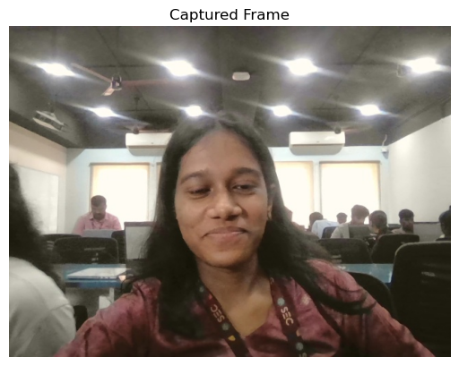
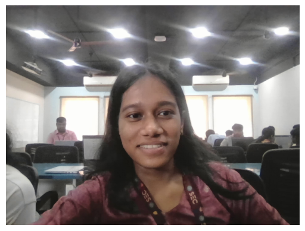
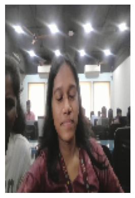
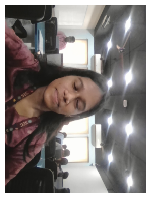

# Ex. No: 02  
# Image Acquisition using Web Camera  

**Name:** krithika v    **Reg. No:** 212225040194


i) Write the frame as JPG file


```python
import cv2
import matplotlib.pyplot as plt
from IPython.display import clear_output
import time
```


```python
cap = cv2.VideoCapture(0)
ret, frame = cap.read()
if ret:
    cv2.imwrite("my_image.jpg", frame)
cap.release()
```


```python
captured_image = cv2.imread('my_image.jpg')
```


```python
plt.imshow(captured_image[:,:,::-1])
plt.title('Captured Frame')
plt.axis('off')
plt.show()
```


    

    


ii) Display the video


```python
cap = cv2.VideoCapture(0)

for i in range(50):
    ret, frame = cap.read()
    if not ret:
        break
    frame_rgb = cv2.cvtColor(frame, cv2.COLOR_BGR2RGB)
    clear_output(wait=True)
    plt.imshow(frame_rgb)
    plt.axis('off')
    plt.show()
    time.sleep(0.05)

cap.release()
```


    

    


iii) Display the video by resizing the window


```python
cap = cv2.VideoCapture(0)

for i in range(50):
    ret, frame = cap.read()
    if not ret:
        break
    resized_frame = cv2.resize(frame, (100, 150))  # Resize to 320x240
    frame_rgb = cv2.cvtColor(resized_frame, cv2.COLOR_BGR2RGB)
    clear_output(wait=True)
    plt.imshow(frame_rgb)
    plt.axis('off')
    plt.show()
    time.sleep(0.05)

cap.release()

```


    

    


 iv) Rotate and display the video


```python
cap = cv2.VideoCapture(0)

for i in range(50):
    ret, frame = cap.read()
    if not ret:
        break
    rotated_frame = cv2.rotate(frame, cv2.ROTATE_90_CLOCKWISE)
    frame_rgb = cv2.cvtColor(rotated_frame, cv2.COLOR_BGR2RGB)
    clear_output(wait=True)
    plt.imshow(frame_rgb)
    plt.axis('off')
    plt.show()
    time.sleep(0.05)

cap.release()
```


    

    


```python

```


```python

```


```python

```
